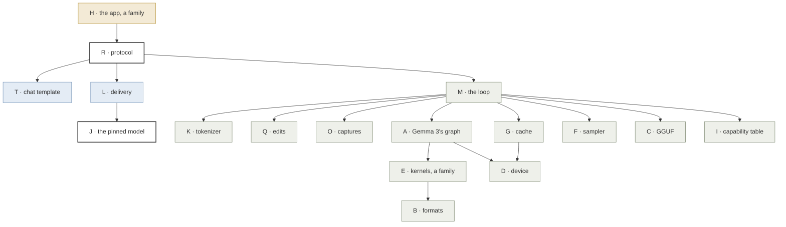
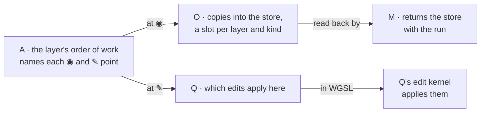

# Change axes

The independent reasons a file changes. One file, one axis; a file whose axis
cannot be named does not get written. [File mapping](file-mapping.md) turns
the axes into files. The letters are names only.

## How the axes depend on each other

An arrow reads "calls or reads". Results come back the other way, through
callbacks the caller passes down. Colour is the part: page, worker, engine.
R and J, outlined, span more than one.

U (build and pins) and V (tests and references) sit beside all of it: U
builds it, V checks it.

## Inside a layer: who owns what

## The axes

| Axis | Changes when | May change |
| --- | --- | --- |
| **A** Gemma 3's graph | The order of work in a layer, or a new ◉ or ✎ point | The graph, its working buffers, where the points sit |
| **B** Weight formats | A format's layout | Device layout, pack, unpack |
| **C** GGUF | The file format, or our parse contract | Reader, types, errors |
| **D** Device | The WebGPU surface or the limits granted | Device, placement, buffer writer, the context the device allows; how GPU results come back, the one place the native and browser builds differ |
| **E** Kernels, a family | A new or faster kernel, in one regime | That kernel only, including the outputs it writes into the capture store |
| **F** Sampler | A sampling method | The sampler, keyed by seed and position |
| **G** Cache | A cache mechanism | Cache, prefix diff, to meet the three-part cache in the [overview](logical-overview.md#the-state-the-cache-in-three-parts) |
| **I** Capability table | What the code implements | The one table, Gemma 3 and its formats |
| **J** The pinned model | The model, or its measured settings | `config/model.json`, policy values |
| **K** Tokenizer | A tokenization algorithm | That algorithm |
| **L** Delivery | A browser network or storage API, how we download | Fetch, SHA-256, OPFS, in TypeScript |
| **M** The loop | A stage in the loop | `load`, `generate`; stops |
| **H** The app, a family | See below | See below |
| **O** Captures | A new captured value, or what is returned | The store, its slots, its layout; the copy and weights launches |
| **Q** Edits | A new kind of edit | The kinds, what each does (a plain function and its WGSL kernel) |
| **R** Protocol | A message | Messages, ids, the latest-answer rule, on both sides of the worker |
| **T** Chat template | A template feature, or how a conversation is rendered | Jinja rendering, in the worker |
| **U** Build | A toolchain pin or build preset | CMake presets, shader embedding, pins, the npm lockfile |
| **V** Evidence | A new contract to guard, or a new reference | Tests, the frozen llama.cpp reference, fixtures, the native tool |

H is a family, as E is: one member per reason the app changes.

| Member | Changes when | May change |
| --- | --- | --- |
| H(frame) | Which views exist and where they sit | The app's root and layout |
| H(view), one per view: the prompt and replies, the deck | That view's design | That view's components and scene |
| H(theme) | The look | Night-glass tokens, fonts, the deck's palette |
| H(session) | What a session holds | The edit set, the copies of captures, the reply to steer from and its history, the branch point, the steered reply |
| H(shape) | How values are presented | Folding vectors into grids, painting, ranking, numbers for reading; plain functions, tested without React |

A family's contract header, such as the model description, the kernel
interface or a weight format's interface, belongs to the family, not to a
member, and changes only when the contract does. `policy/` is a contract;
its values are J's.

Two rules:

- **Widths come from the model description.** O, Q and H never hold 26,
  1,152 or 6,912; they read them from A's description. H folds vectors into
  grids; O returns them flat.
- **One responsibility, two languages,** as a kernel is WGSL and C++. R is
  the envelope: messages, ids, the latest-answer rule, in the C++ bindings
  and the TypeScript client. Q owns its TypeScript mirror, the edit kinds
  (`app/src/engine/edits.ts`), so a new edit kind does not touch R. The
  captures' type is in R's messages (`app/src/protocol/messages.ts`), so a
  new captured value sent to the page touches R. Q's edit kernel is Q's rule
  in WGSL, tested against Q's plain function, not against itself.

The shared kernels and the graph still carry branches for other model
families. Removing them is its own change, on E or A.

## Not axes

Fixed by scope. Swapping one is an architectural change, not a local one.

| Fixed | Why | What a swap would touch |
| --- | --- | --- |
| WebGPU, for all GPU work | Frizzle exists to run in a browser on WebGPU | A, D, E, G, O, Q |
| React, with react-three-fiber | The app's one framework | H only, because L, R, T and Q's mirror are plain TypeScript and import no React |

## Boundary tests

| Change | Touches | Leaves alone |
| --- | --- | --- |
| Capture another value at a point in the layer | E (the kernel that holds it), A, O, M | Q, G, R, H |
| A new edit kind on the neurons | Q, its TypeScript mirror, H | O, R, G, F |
| The deck's colours | H(theme) | Everything else, the deck view included |
| The deck reworked | H(view) for the deck | The other views, H(session), H(shape) |
| Another quantization of the same model | J, I, V, and B if the format is new | A, O, Q, H |
| A new Gemma template revision | T | K, the engine: it receives text |
| How seeds are derived | F | M, Q |
| Dawn moves to a new release | U, D if the surface changed | Everything above D |
