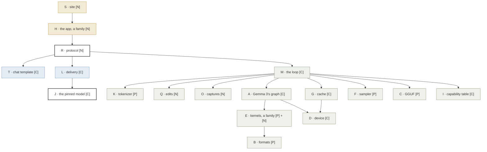
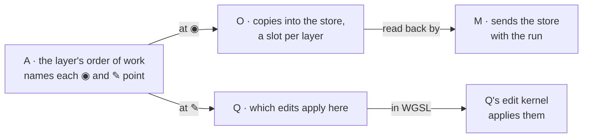

# Change axes

Draft for review, 2026-10-28. The independent reasons a file changes. One
file, one axis; a file whose axis cannot be named does not get written.
[File mapping](file-mapping.md) turns the axes into files.

**Legend:** **[P]** ported from Charlotte as it is · **[C]** ported, then
changed · **[N]** new.

Ported code is a starting point, not a constraint: where it falls short of
Frizzle's requirements, the code changes, never the requirement.

Charlotte's letters are kept only as names, because many of the ported files'
headers cite them. Frizzle's own work takes new letters. Charlotte's N (media) and
M(encode) do not come over.

## How the axes depend on each other

An arrow reads "calls or reads". Results come back the other way, through
callbacks the caller passes down, as Charlotte streams tokens. Colour is the part:
page, worker, engine. R and J, outlined, span more than one.

U (build and pins) and V (tests and references) sit beside all of it: U
builds it, V checks it.

## Inside a layer: who owns what

## The axes

| Axis | Changes when | May change |
| --- | --- | --- |
| **A** Gemma 3's graph [C] | The order of work in a layer, or a new ◉ or ✎ point | The graph, its working buffers, where the points sit |
| **B** Weight formats [P] | A format's layout | Device layout, pack, unpack |
| **C** GGUF [P] | The file format, or our parse contract | Reader, types, errors |
| **D** Device [C] | The WebGPU surface or the limits granted | Device, placement, buffer writer, the context the device allows (from preflight); how GPU results come back, the one place the native and browser builds differ |
| **E** Kernels [P] + [N] | A new or faster kernel, in one regime | That kernel only. New: attention writing its weights |
| **F** Sampler [P] | A sampling method | The sampler, already keyed by seed and position |
| **G** Cache [C] | A cache mechanism | Cache, prefix diff, to meet the three-part cache in the overview |
| **I** Capability table [C] | What the code implements | The one table, trimmed to Gemma 3 |
| **J** The pinned model [C] | The model, or its measured settings | `config/model.json`, policy values |
| **K** Tokenizer [P] | A tokenization algorithm | That algorithm |
| **L** Delivery [C] | A browser network or storage API, how we download | Fetch, SHA-256, OPFS, in TypeScript |
| **M** The loop [C] | A stage in the loop | `load`, `generate`; stops |
| **H** The app [N], a family | See below | See below |
| **O** Captures [N] | A new captured value, or what is sent | The store, its slots, its layout |
| **Q** Edits [N] | A new kind of edit | The kinds, what each does (a plain function and its WGSL kernel) |
| **R** Protocol [N] | A message | Messages, ids, the latest-answer rule, on both sides of the worker |
| **S** Site [N] | Pages, the family shell | Hugo, the hand-over into the app |
| **T** Chat template [C] | A template feature, or how a conversation is rendered | Jinja rendering, now in the worker |
| **U** Build [C] | A toolchain pin or build preset | CMake presets, shader embedding, pins, the npm lockfile |
| **V** Evidence [C] | A new contract to guard, or a new reference | Tests, llama.cpp references, fixtures, the native tool |

H is a family, as E is: one member per reason the app changes.

| Member | Changes when | May change |
| --- | --- | --- |
| H(frame) | Which views exist and where they sit | The app's root and layout |
| H(view), one per view: prompt and replies, pass map, deck, later the residual view | That view's design | That view's components and scene |
| H(theme) | The look | Night-glass tokens, fonts |
| H(session) | What a session holds | The edit set, the copies of captures, the original reply |
| H(shape) | How values are presented | Folding vectors into grids, ranking; plain functions, tested without React |

A family's contract header, such as the model description, the kernel
interface or a weight format's interface, belongs to the family, not to a
member, and changes only when the contract does. Charlotte filed `policy/` as
a contract; here its values are J's.

Two rules:

- **Widths come from the model description.** O, Q and H never hold 26,
  1,152 or 6,912; they read them from A's description. H folds vectors into
  grids; O sends them flat.
- **One responsibility, two languages,** as a kernel is WGSL and C++. R is
  the envelope: messages, ids, the latest-answer rule, in the C++ bindings
  and the TypeScript client. O and Q each own their own TypeScript mirror,
  the store's layout and the edit kinds, so a new capture or edit kind does
  not touch R. Q's edit kernel is Q's rule in WGSL, tested against Q's plain
  function, not against itself.

Charlotte's branches for other model families come over intact in the shared
kernels and graph. Removing them is its own change, on E or A.

## Not axes

Fixed by scope. Swapping one is an architectural change, not a local one.

| Fixed | Why | What a swap would touch |
| --- | --- | --- |
| WebGPU, for all GPU work | Frizzle exists to run in a browser on WebGPU | A, D, E, G, O, Q |
| React, with react-three-fiber | The app's one framework | H only, because L, R, T and the O and Q mirrors are plain TypeScript and import no React |

## Boundary tests

| Change | Touches | Leaves alone |
| --- | --- | --- |
| Capture attention weights (slice 5) | E(attention), A, O, H | Q, G, M, R |
| Edit residual dimensions (slice 7) | Q, E (the add-and-norm kernel opens up), A, H | O (already captured), R, G, F |
| The deck's colours | H(theme) | Everything else, the deck view included |
| The deck reworked | H(deck) | The other views, H(session), H(shape) |
| Another quantization of the same model | J, I, V, and B if the format is new | A, O, Q, H |
| A new Gemma template revision | T | K, the engine: it receives text |
| How seeds are derived | F | M, Q |
| Dawn moves to a new release | U, D if the surface changed | Everything above D |
