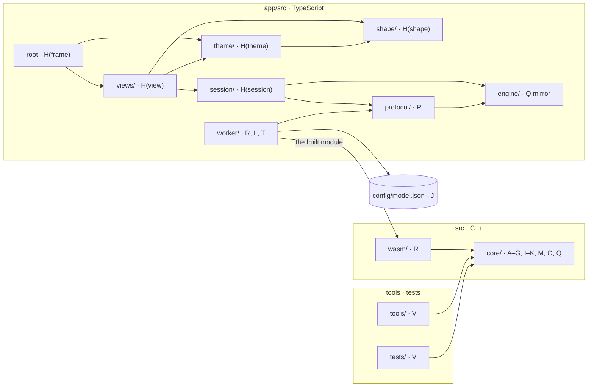

# File mapping

How the [change axes](change-axes.md) become directories and files. The axis
belongs to the file. A directory holds one axis plus, where there is one,
that family's contract header. `src/core/arch/` is the exception: its
entry and `gemma3/` (A) and `describe` (C) sit together because each names
the others.

## The repository

An arrow reads "imports, includes or loads". Every boundary that matters is an
arrow that is not there; the rules below say which.



`python3 scripts/check.py boundaries` enforces these rules, reading the
sources:

| Rule | Why |
| --- | --- |
| `src/core/` includes nothing from `src/wasm/`, `tools/` or `tests/` | The core never knows it is in a browser, so it builds and tests natively |
| React is imported only by the root, `views/` and `theme/` | Swapping React touches H only ([not an axis](change-axes.md#not-axes)) |
| three.js and react-three-fiber are imported only by `views/` | The scene is a view's; `theme/` hands it colours as plain numbers, and `shape/` stays testable in Node |
| `session/`, `shape/`, `engine/`, `protocol/` and `worker/` are plain TypeScript | Tested without React; the worker pulls no React into its bundle |
| `worker/` imports nothing from `views/`, `session/`, `shape/` or `theme/` | The worker is the engine's side; the page talks to it only through `protocol/` |

## The engine, `src/`

| Path | Axis | What it holds |
| --- | --- | --- |
| `core/arch/`, `core/model/` | A, C | Gemma 3's description and the order its graph runs the blocks |
| `core/graph/graph.*` | A | The layer's blocks; the ◉ and ✎ points |
| `core/formats/<format>/` | B | F32, F16, Q4_0, Q4_1, Q8_0 |
| `core/gguf/` | C | The file reader |
| `core/gpu/`, `core/residency/`, `core/kernels/program`, `order`, `schedule`, `core/run_guard.h` | D | Device, placement, upload, launching; the context offered is sized in `residency/plan` |
| `core/kernels/<kernel>/` | E | gather, matmul, norm, rope, attention, top-k |
| `core/kernels/attention/` | E | Also writes the last row's scores and their maximum and sum into the capture store |
| `core/kernels/norm/` | E | Also writes the residual and what each block adds into the capture store |
| `core/sampler/` | F | Keyed by seed and position |
| `core/cache/kv.*` | G | The three-part cache in the [overview](logical-overview.md#the-state-the-cache-in-three-parts) |
| `core/cache/prefix.*` | G | The prefix diff |
| `core/capability/capability.cpp` | I | Gemma 3 and its formats |
| `core/policy/` | contract | What can be configured. The values are J's, from `config/model.json` |
| `core/tokenizer/` | K | SentencePiece BPE |
| `core/runtime/runtime.*`, `turn.*`, `stops.*` | M | The turn loop |
| `core/runtime/generator.*` | M | Text in, text out over the turn loop |
| `core/runtime/engine.*` | M | `load` and `generate`, the operations every host calls |
| `core/capture/` | O | The store, its slots a layer and kind, its layout (`capture.h`); `capture.wgsl`, the neurons' copy, and its launcher; `weights.wgsl` and its launcher, the attention scores into weights (`weights.h`); the reader that brings the store back once a run (`reader.h`) |
| `core/edit/` | Q | Edit kinds and what each does as a plain function; `edit.wgsl` and its launcher |
| `core/diagnostics.h` | U | The build's instrumentation gate |
| `ported.json` | V | Each ported file's SHA-256 as ported, written by `scripts/port_charlotte.py`; tells unchanged files from changed ones |
| `wasm/bindings.cpp` | R | The operations for the worker; the only Emscripten-aware C++ |
| `shaders/vector_add.wgsl` | D | The device self-check |

Q's kernel sits in `core/edit/`, not `core/kernels/`: it is Q's rule written
in WGSL, and adding an edit kind changes both files.

## The app, `app/src/`

```text
main.tsx, App.tsx      H(frame)
views/prompt/          H(view)   the prompt, both replies, the pin chips
views/deck/            H(view)   the MLP workbench: Workbench.tsx, Deck.tsx
                                 (the layer deck), LayerMap.tsx (the Map),
                                 Inspector.tsx, cards.ts
theme/                 H(theme)  night glass: theme.css (tokens, the page's elements),
                                 palette.ts (the deck's colours), fonts/ (Plex, kept)
session/               H(session) session.ts (the page's state), pins.ts (the pin set:
                                 adding, removing, grouping, what a pin sends),
                                 branch.ts (the reply's words and the branch point)
shape/                 H(shape)  fold.ts (a slot into the deck's grid, a box of cells
                                 back to neurons), paint.ts (a slot into pixels, a heat
                                 map of size, and overlays), rank.ts (the
                                 strongest), strip.ts (a slot into one of the
                                 Map's strips, a column's scale), numbers.ts
                                 (MB, values for reading)
engine/edits.ts        Q         the edit kinds, as sent
protocol/              R         messages, ids, the page's client, starting the worker;
                                 the captures as the page receives them (messages.ts)
worker/worker.ts       R         the worker's entry; answers the page's requests
worker/engine/         R         the engine's module behind the worker's calls
worker/delivery/       L         fetch, SHA-256, OPFS, streaming into the engine
worker/template/       T         Gemma's chat template; @huggingface/jinja from npm
```

Two Vite entries, the page and the worker. `worker/delivery/` reads
`config/model.json`.

## Build, tools and tests

| Path | Axis | What it holds |
| --- | --- | --- |
| `CMakeLists.txt`, `CMakePresets.json`, `cmake/` | U | Native and browser presets, shader embedding, the Dawn pin |
| `app/package.json`, lockfile, Vite config | U | Exact npm versions |
| `tools/frizzle/` | V | The native tool: the reply to a prompt, and the edited reply beside it |
| `tools/reference_logits/` | V | Makes llama.cpp's logits, the frozen reference, again; its own build against llama.cpp |
| `scripts/` | U, V | Python: checks, fetching Dawn and the pinned model, the mechanical port, the test fixtures |
| `tests/integration/<scenario>/` | V | One directory per scenario: `reference-logits`, `replay` ([inventory](../../tests/README.md)) |
| `tests/contracts/<suite>/` | V | One per suite in the inventory |
| `tests/fixtures/` | V | Small inputs and frozen references |
| `tests/support/` | V | What the tests share: reading files, driving the GPU, doctest's main |

## Names

All C++ is in namespace `frizzle`, macros prefixed `FRIZZLE_`. A ported file
names its axis in its header once it changes
([instructions](../../AGENTS.md#design-in-the-files)); until then this
mapping is its record.
