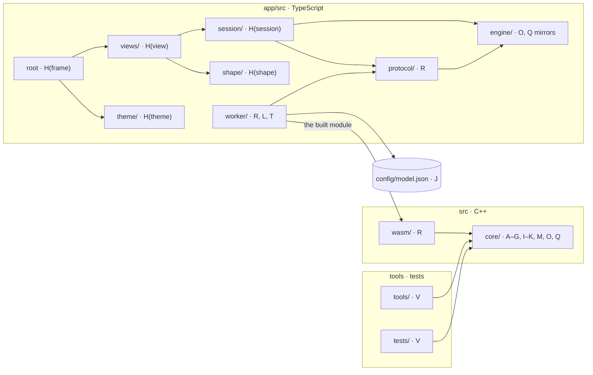

# File mapping

Draft for review, 2026-10-28. How the [change axes](change-axes.md) become
directories and files. Files ported whole are mapped by directory and listed
in the [inventory](../research/2026-10-27-charlotte-inventory.md); files that
change or are new are mapped one by one.

**Legend:** **[P]** ported from Charlotte as it is · **[C]** ported, then
changed · **[N]** new.

The axis belongs to the file. A directory holds one axis plus, where there is
one, that family's contract header. `src/core/arch/` is the exception: its
contract, `describe` (C) and `gemma3/` (A) sit together because each names the
others.

## The repository

An arrow reads "imports, includes or loads". Every boundary that matters is an
arrow that is not there; the rules below say which.



| Rule | Why |
| --- | --- |
| `src/core/` includes nothing from `src/wasm/`, `tools/` or `tests/` | The core never knows it is in a browser, so it builds and tests natively |
| React is imported only by the root, `views/` and `theme/` | Swapping React touches H only ([not an axis](change-axes.md#not-axes)) |
| `session/`, `shape/`, `engine/`, `protocol/` and `worker/` are plain TypeScript | Tested without React; the worker pulls no React into its bundle |
| `worker/` imports nothing from `views/`, `session/`, `shape/` or `theme/` | The worker is the engine's side; the page talks to it only through `protocol/` |

`python3 scripts/check.py boundaries` will enforce them, the C++ rule from
slice 1 and the TypeScript rules from slice 3.

## The engine, `src/`

| Path | Axis | Origin | What it holds |
| --- | --- | --- | --- |
| `core/arch/`, `core/model/` | A, C, contract | [P] | Gemma 3's description and the order its graph runs the blocks |
| `core/graph/graph.*` | A | [C] | The layer's blocks; the ◉ and ✎ points; running position n−1 from layer L |
| `core/formats/<format>/` | B | [P] | F32, F16, Q4_0, Q4_1, Q8_0 |
| `core/gguf/` | C | [P] | The file reader |
| `core/gpu/`, `core/residency/`, `core/kernels/program`, `order`, `schedule`, `core/run_guard.h` | D | [P] | Device, placement, upload, launching; the context offered is sized in `residency/plan` |
| `core/kernels/<kernel>/` | E | [P] | gather, matmul, norm, rope, attention, top-k |
| `core/kernels/attention/` | E | [C] | Writing the attention weights (slice 5) |
| `core/kernels/norm/` | E | [C] | Opening up the add and the norm, if slice 7 needs it |
| `core/sampler/` | F | [P] | Keyed by seed and position |
| `core/cache/kv.*` | G | [C] | The three-part cache in the [overview](logical-overview.md#the-state-the-cache-in-three-parts) |
| `core/cache/prefix.*` | G | [P] | The prefix diff |
| `core/capability/capability.cpp` | I | [C] | Trimmed to Gemma 3 and its formats |
| `core/policy/` | contract | [P] | What can be configured. The values are J's: they come from `config/model.json`, which gains the measured settings once measured |
| `core/tokenizer/` | K | [P] | SentencePiece BPE |
| `core/runtime/runtime.*`, `generator.*`, `turn.*`, `stops.*` | M | [C] | `load`, `prompt`, `predict`, `generate` |
| `core/capture/` | O | [N] | The store, a slot per layer, its layout |
| `core/edit/` | Q | [N] | Edit kinds and what each does as a plain function; the first layer where two sets differ; `edit.wgsl` and its launcher |
| `core/diagnostics.h` | U | [P] | The build's instrumentation gate |
| `wasm/bindings.cpp` | R | [N] | The four operations for the worker; the only Emscripten-aware C++ |
| `shaders/vector_add.wgsl` | D | [P] | The device self-check |

Not ported: `preflight/`. Its one caller is Charlotte's `bindings.cpp`, which
is rewritten, and the context offered is already sized in `residency/plan`.

Q's kernel sits in `core/edit/`, not `core/kernels/`: it is Q's rule written
in WGSL, and adding an edit kind changes both files.

## The app, `app/src/`

```text
main.tsx, App.tsx      H(frame)
views/prompt/          H(view)   prompt, first-token prediction, both replies
views/pass-map/        H(view)   slice 5
views/deck/            H(view)   the MLP workbench
views/residual/        H(view)   slice 7
theme/                 H(theme)  night-glass tokens, fonts
session/               H(session)
shape/                 H(shape)  folding, ranking
engine/captures.ts     O         the store's layout, read from the wire
engine/edits.ts        Q         the edit kinds, as sent
protocol/              R         messages, ids, the page's client
worker/worker.ts       R         the worker's entry; loads the module
worker/delivery/       L         fetch, SHA-256, OPFS, streaming into the engine
worker/template/       T         Gemma's chat template; vendored Jinja
```

Two Vite entries, the page and the worker. `worker/delivery/` reads
`config/model.json`.

## Build, tools and tests

| Path | Axis | What it holds |
| --- | --- | --- |
| `CMakeLists.txt`, `CMakePresets.json`, `cmake/` | U | Native and browser presets, shader embedding, the Dawn pin |
| `app/package.json`, lockfile, Vite config | U | Exact npm versions |
| `tools/frizzle/` | V | The native tool: the prediction and both replies for a prompt |
| `tools/reference_logits/` | V | llama.cpp's logits, the frozen reference |
| `scripts/` | U, V | Python: checks, fetching Dawn and test data, fixture generators |
| `tests/integration/<scenario>/` | V | One directory per scenario in the [inventory](../../tests/README.md): `reference-logits`, `replay`, `browser`, `site` |
| `tests/contracts/<suite>/` | V | One per suite: `tokenizer`, `gguf`, `kernels`, `edits` |
| `tests/fixtures/` | V | Small inputs and frozen references |
| `web/` | S | Hugo; mapped in slice 6 |

Charlotte's tests come over only where one implements an inventory row.

## Names and axis lines

- All C++ is in namespace `frizzle`, macros prefixed `FRIZZLE_`. Ported files
  are renamed mechanically on porting, which the
  [workflow](../process/workflow.md#file-header-comments) does not count as a
  change.
- 82 of the 128 ported files (112 C++, 16 WGSL) name no axis in their
  header. 21 of them are headers; most of the rest are `.cpp` files whose
  header carries it.
  This mapping is their record; each gains its line when it next changes for
  another reason.

## Not settled

- **`platform.js` and `platform_policy.js`,** inventoried for porting: which
  browsers Frizzle runs in and the memory budget. Their home waits on the open
  decision about supported browsers and devices.
- **Where the Emscripten build lands** for Vite to load (U, slice 3).
