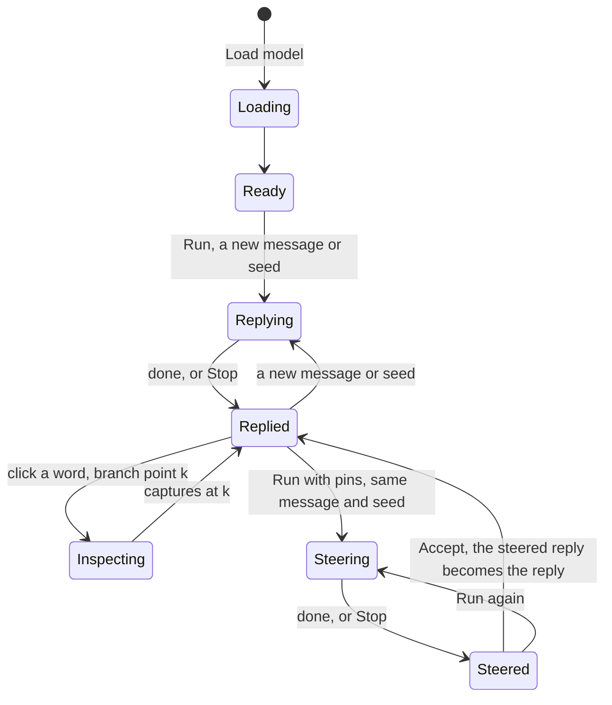
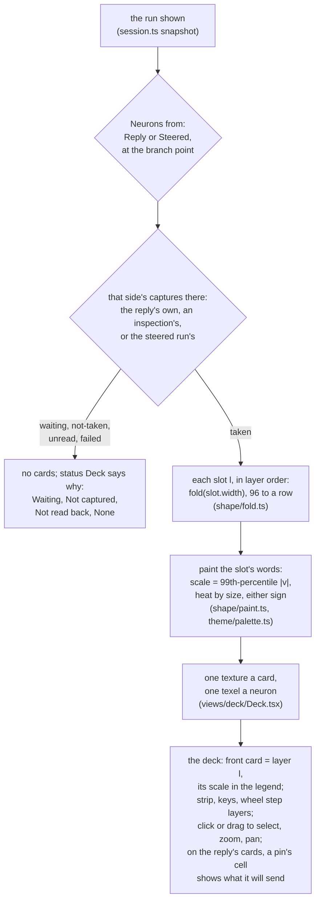

# Interface

The app on the page: what it shows, what a person changes, and how a session
moves. Everything shown is the model's own output at the branch point,
rounded for reading and exact in a `<data value>`. The look follows the
approved concepts in `docs/design/concepts/`.

## The page

```text
┌─ header ─────────────────────────────────────────────────────────────┐
│ Frizzle                   WebGPU: the device · Model: size, progress │
├─ the conversation, full width ───────────────────────────────────────┤
│ Message …………………………………………………………… Seed [1]   [Load model | Run] [Stop] │
│ pins held, as chips                                 [Open neurons]   │
├──────────────────────────────────┬───────────────────────────────────┤
│ Reply                            │ Steered reply                     │
│ words; the branch point marked,  │ the kept text faded,              │
│ the text past it faded           │ its own text after it             │
│ Running / Done / Failed          │ Waiting / Not steered / …         │
│ [Neurons in the reply]           │ [Accept] [Neurons in the steered] │
└──────────────────────────────────┴───────────────────────────────────┘

┌─ the workbench, a layer over the whole window ───────────────────────┐
│ ← Close  prompt › where   View: (Deck) Map   pins as chips    [Run]  │
├──────────────────────────────────────────┬───────────────────────────┤
│ the layer deck, or the Map               │ the inspector             │
│ one card per layer, front card = layer l │ Neurons from: Reply or    │
│ 96 × 72 neurons, heat by size            │   Steered                 │
│ legend: the front layer's scale          │ the strongest in layer l  │
│ strip of layers                          │ neuron or selection card: │
│                                          │   Set · Scale × · Zero    │
│                                          │ Go to a neuron            │
└──────────────────────────────────────────┴───────────────────────────┘
```

- Until the model is ready, Load model sits in Run's place, with the
  model's size, then the load's progress in megabytes, or its failure.
- The workbench opens from the prompt, a reply or a pin's chip, and Run
  closes it so the replies show as they stream. Reading and working on
  neurons happen in turns.
- The two reply panes scroll together. Each pane is at most about half the
  window high and scrolls on its own keys when focused.

## A session



| Control | Does |
| --- | --- |
| A word in the reply, or From the start | Sets the branch point k after it. ← and → move it a word. Disabled while a run is going |
| Run | With no reply, or a new message or seed: a new reply, then a steered run from its start if pins are held. With the reply done and the same message and seed: the steered reply from k with the pins held |
| Stop | Beside Run while a run goes or waits. Ends it "cancelled" with its tokens so far and no captures; it can still be steered from or accepted |
| Accept | The steered reply becomes the reply, its edits its history, k where it branched. An accepted stopped reply's neurons at k come from an inspection |
| Set, Scale ×, Zero | Pin the selection, in the front layer, for the next run |

- Pins are kept throughout: across runs, Accept and new messages. They wait
  on the prompt as chips, one a layer and edit; a range pinned at once is
  one chip. Each is removable.
- At the branch point the deck shows the reply's own captures if they were
  taken there, otherwise an inspection's (a run that draws no token).
- Requests run one at a time: a branch follows the reply and waits for an
  inspection in flight.

## The deck

How the deck draws a run's neurons, when the shown captures change and never
per frame.



| Rule | Why |
| --- | --- |
| Heat by size, either sign | A neuron pushes the residual as far either way; the sign is in the tip and the inspector |
| Each card scaled to its own layer's 99th-percentile magnitude, given in the legend to two significant digits | A few outliers do not darken the rest |
| Infinities full heat, NaN magenta; neither sets the scale | Every value is shown, none distorts the others |
| One side at a time on the deck; both on the neuron card | The cards compare layers; the card compares runs |
| A pinned cell on the reply's card shows the value it will send | A pin answers on the grid at once; the steered reply's card shows what its run used |
| Sizes in megabytes, values rounded for reading | Human units; the exact value is in the inspector's data |

## The Map

The workbench's other view, in the deck's place, beside the inspector: every
layer at the branch point, one row a layer, from the same captures as the
deck.

```text
            Residual in   Attention added   MLP neurons, 6,912     MLP added
            0 ▬▬▬▬ s      0 ▬▬▬▬ s          0 ▬▬▬▬▬▬▬▬▬▬ s          0 ▬▬▬▬ s
Layer 0     ▮▮▮▮▮▮▮▮      ▮▮▮▮▮▮▮▮          ▮▮▮▮▮▮▮▮▮▮▮▮▮▮▮▮▮▮      ▮▮▮▮▮▮▮▮
Layer 1 ●2  ▮▮▮▮▮▮▮▮      ▮▮▮▮▮▮▮▮          ▮▮▮▮▮▮▮▮▮▮▮▮▮▮▮▮▮▮      ▮▮▮▮▮▮▮▮
…           a mark a group, each group sized so every mark has a pixel
Layer 25
```

| Rule | Why |
| --- | --- |
| Columns in the order a layer computes them; the residual is the stream coming in, layer 0's the embedding | What is captured, named as it is |
| A mark a group, the group's strongest value, either sign | Every mark is one value the run made, chosen, never summed or averaged; the reading names its index |
| Each column's group the smallest that gives every mark a physical pixel, stated under its heading | A stretched strip with more marks than pixels drops some, the strongest among them; a finer screen shows more |
| Heat by size, the deck's ramp | A hot mark on the Map is a hot neuron on the deck |
| One scale a column across all layers, its 99th-percentile magnitude, in the column's legend | The Map compares layers; each column its own, since the residual's sizes are not the neurons' |
| Click a neuron mark to select it; click elsewhere in a row for its layer | The inspector beside shows it; residual dimensions are not editable |
| No pin preview | Every mark is a captured value |

The deck, the Map and the inspector read the same snapshot as the
conversation; the only thing they change in the session is the pins held
for the next run.
The workbench gives the deck the focus on opening, so the wheel and keys
work without a first click.

## The look

Night glass: midnight surfaces, values as amber points of light, IBM Plex
Serif and Plex Mono kept in the app (`theme/theme.css`, `theme/palette.ts`).
three.js draws the deck through react-three-fiber with the WebGL renderer,
on the page; the engine's WebGPU device is the worker's.
