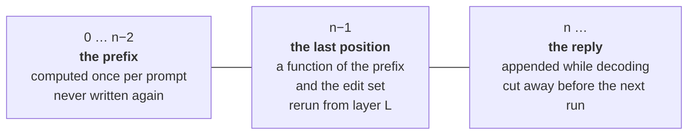
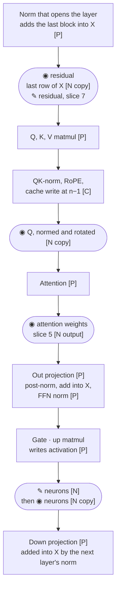
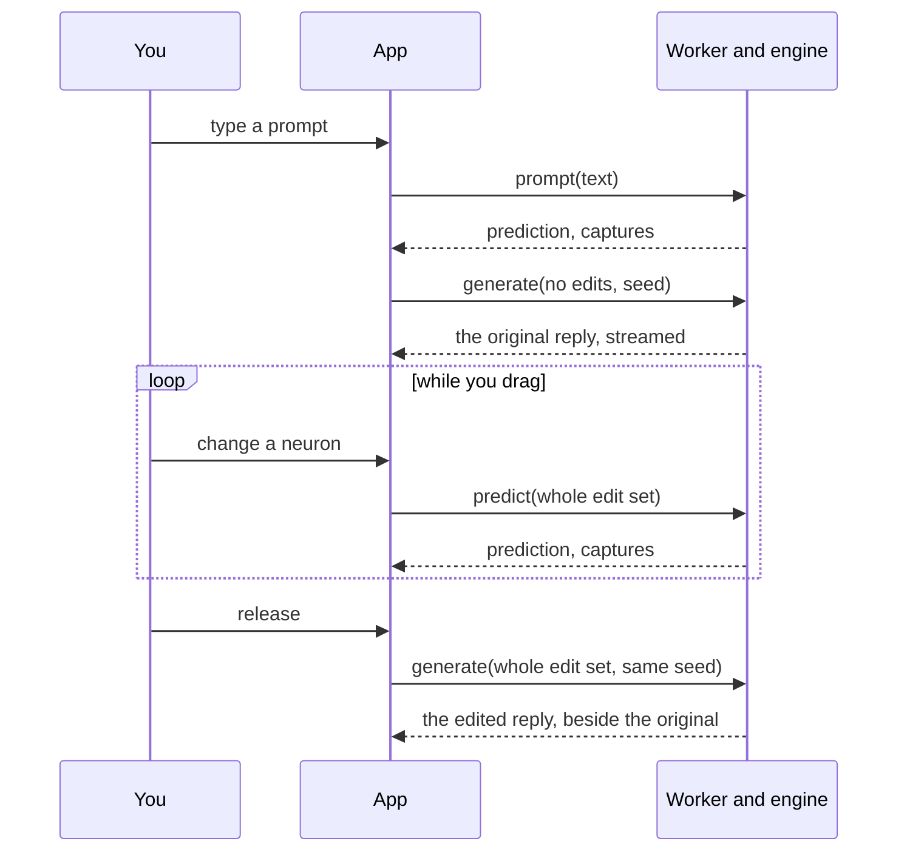

# Logical overview

Draft for review, 2026-10-27. What Frizzle is made of, what state it keeps,
and where values are read and changed. Decisions themselves are in
[MEMORY](../process/MEMORY.md).

**Legend:** **[P]** ported from Charlotte as it is · **[C]** ported, then
changed · **[N]** new. ◉ capture · ✎ edit.

## The parts

Arrows are labelled: what crosses, or who owns what.

One engine source, two builds, one `webgpu.h`. Everything the native tool and
the tests exercise is the same code the browser runs.

The worker host renders the chat template, so the page sends only the
prompt's text. Charlotte renders it on the page; it moves here to sit with
the file it is read from.

| Part | Owns | Offers | Does not own |
| --- | --- | --- | --- |
| Site | Pages, the family shell | A home for the built app | Anything in the model |
| App | The edit set, what is on screen, copies of captures | Requests | The device, the model, tokens |
| Worker host | The file: download, verify, cache; the chat template | The worker side of the protocol | The GPU |
| Engine | Weights on the GPU, the cache, the edit set position n−1 was computed under, the sampler | `load`, `prompt`, `predict`, `generate` | The page; the file on disk |
| Native tool, tests | Fixtures, references | Nothing to the product | Anything the browser build does not also do |

## The four operations

| Operation | Does | Returns |
| --- | --- | --- |
| `load(file)` | Read the GGUF, put the weights on the GPU | Ready, or a named refusal |
| `prompt(text)` | Template, tokenize, compute the prefix and position n−1 with no edits | Prediction and captures |
| `predict(edits)` | Bring n−1 to these edits | Prediction and captures |
| `generate(edits, seed)` | Bring n−1 to these edits, then decode with them held | Tokens, streamed |

"Bring n−1 to these edits" is one rule, shared by `predict` and `generate`:
cut the cache back to the prompt, then rerun n−1 from the first layer where
the new edit set differs from the one n−1 was computed under. Nothing differs,
nothing reruns.

## The state: the cache in three parts

These are Frizzle's requirements on the cache. Cutting the reply away never
recomputes the prompt, whatever the reply's length. Rerunning n−1 from layer
L leaves the layers below it untouched. Charlotte's cache is where the code
starts, and it changes wherever it falls short.

## Inside one layer: where values are read and changed

Top to bottom is the order of work for position n−1.

Each capture is copied out at its point into a capture store with a slot
per layer, so it holds what the model used even if the buffer it came from
is reused. A rerun from layer L rewrites slots L onward; the
slots below are already right. Every `prompt` and `predict` sends the whole
store to the page, so switching layers never asks the engine for anything.

| Per layer, at f32 | Size |
| --- | --- |
| Residual, 1,152 | 4.5 KiB |
| Q, 4 heads × 256 | 4 KiB |
| Neurons, 6,912 | 27 KiB |
| Attention weights, 4 heads × positions (slice 5) | 16 B per position |
| **All 26 layers, 512-token prompt** | **about 1.1 MiB** |

That is a small fraction of one decode step's reads (the 722 MB of weights),
and a dropped predict sends nothing. An edited stage is captured after its
edit: the screen shows what the model used. The unedited values are the
store from the run without edits, which the app keeps.

Editing the residual (slice 7) lands between the add and the normalization,
which are one kernel today. How to open that up is slice 7's design.

## The loop

The original reply is generated once per prompt, before any edit, and kept.

## What must stay true

1. The prefix, 0 … n−2, is computed once per prompt and never written again.
2. Position n−1 depends only on the prefix and the edit set. The engine reruns
   it from the first layer where the new set differs from the one it was
   computed under; removing an edit is a difference.
3. With no edits, or Scale × 1, n−1 and everything decoded after it are bit for
   bit the original.
4. The app sends the whole edit set with every request, and the engine works
   out the difference. Neither holds a change list for the other.
5. A capture is a copy taken inside the pass at its point. An edited stage is
   captured after its edit. The capture store always matches the current
   state of n−1, for every layer, and is sent whole.
6. The original and edited replies use the same seed. The sampler is keyed by
   seed and position, and edits are applied at every decode step, so the edits
   are the only difference.
7. Every request carries an id, and the page shows only the answer to its
   latest one. The worker may drop a predict that a newer one replaces, never
   a generate.

## Not settled here

- Whether gate and up are shown separately (new kernel outputs).
- How the residual edit opens up the add-and-norm kernel (slice 7).
- How a rerun from layer L starts (slice 2). The ported norm kernel adds into
  X and normalizes in one step; it can change if that is in the way.
