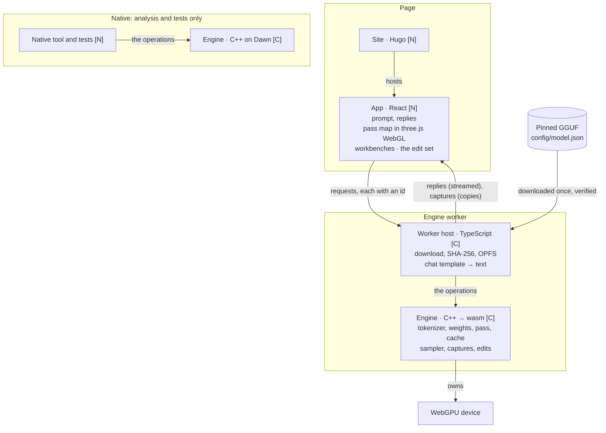
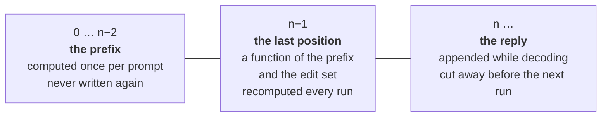
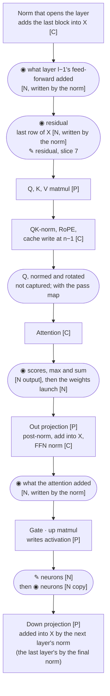
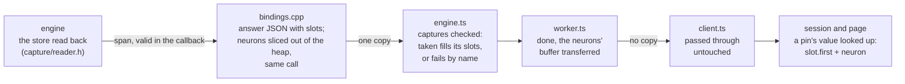
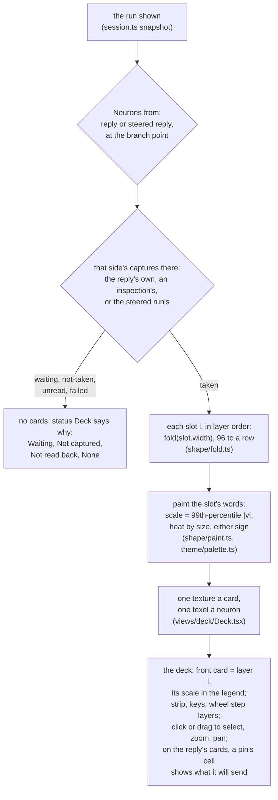
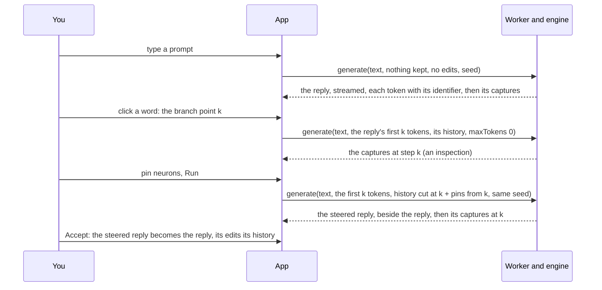

# Logical overview

Draft for review, 2026-10-27. What Frizzle is made of, what state it keeps,
and where values are read and changed. Decisions themselves are in
[MEMORY](../process/MEMORY.md).

**Legend:** **[P]** ported from Charlotte as it is · **[C]** ported, then
changed · **[N]** new. ◉ capture · ✎ edit.

## The parts

Arrows are labelled: what crosses, or who owns what.

One engine source, two builds, one `webgpu.h`. Everything the native tool and
the tests exercise is the same code the browser runs.

The worker host renders the chat template, so the page sends only the
prompt's text. Charlotte renders it on the page; it moves here to sit with
the file it is read from.

| Part | Owns | Offers | Does not own |
| --- | --- | --- | --- |
| Site | Pages, the family shell | A home for the built app | Anything in the model |
| App | The edit set, what is on screen, copies of captures | Requests | The device, the model, tokens |
| Worker host | The file: download, verify, cache; the chat template | The worker side of the protocol | The GPU |
| Engine | Weights on the GPU, the cache, the sampler | `load`, `generate` | The page; the file on disk |
| Native tool, tests | Fixtures, references | Nothing to the product | Anything the browser build does not also do |

## The operations

| Operation | Does | Returns |
| --- | --- | --- |
| `load(file)` | Read the GGUF, put the weights on the GPU | Ready, or a named refusal |
| `generate(text, kept, edits, seed)` | Run the model over the rendered prompt and the reply tokens a branch keeps, each edit at the steps its range holds; a limit of 0 inspects, drawing nothing | The reply, streamed a token at a time with its identifier; then its end, its identifiers, and every layer's captures at the input's last position, step k |

Frizzle shows what the model produces and computes nothing beside it. The
cache keeps the prompt's prefix between runs, so running the same prompt
with other edits recomputes only the last position before decoding.

## The state: the cache in three parts

These are Frizzle's requirements on the cache. Cutting the reply away never
recomputes the prompt, whatever the reply's length. Charlotte's cache is where
the code starts, and it changes wherever it falls short.

## Inside one layer: where values are read and changed

Top to bottom is the order of work for position n−1.

Each capture is written at its point into a capture store, a slot per
layer and kind, so it holds what the model used even if the buffer it came
from is reused (capture/capture.h). The neurons are copied by a launch of
their own; the residual and what each block adds are written by the norm
kernel, the only place the added vector exists; the attention kernel
writes the last row's scores and its final maximum and sum, and a launch
after it turns them into weights. Every word of the store is written in
the step that ends the prompt (slice 4, step 5).

| Per layer, at f32 | Size | Captured |
| --- | --- | --- |
| Neurons, 6,912 | 27 KiB | From slice 4: 702 KiB a run for 26 layers |
| Residual, 1,152 | 4.5 KiB | From slice 4, step 5 |
| What the attention adds, 1,152 | 4.5 KiB | From slice 4, step 5 |
| What the feed-forward adds, 1,152 | 4.5 KiB | From slice 4, step 5 |
| Attention weights, 4 heads × keys | 8 KiB for a 512-key window; 512 KiB for a global layer, sized to the trained 32,768 | From slice 4, step 5 |
| Each head's softmax maximum and sum | 32 B | From slice 4, step 5 |
| Q, 4 heads × 256 | 4 KiB | With the pass map (slice 5) |
| **The store, 26 layers** | **3.2 MiB, 2 MiB of it the 4 global layers' weights** | |

That is a small fraction of one decode step's reads (the 722 MB of
weights). Until slice 4's step 6 only the neurons cross to the page; the
rest is read back with them. An edited stage is captured after its
edit: the screen shows what the model used. The unedited values are the
store from the run without edits, which the app keeps.

Editing the residual (slice 7) lands between the add and the normalization,
which are one kernel today. How to open that up is slice 7's design.

## A run's captures: when the store is written and read

The store is written once a run, inside the step that ends the prompt, and
read once, after the turn ends. The copy and weights launches run in every
step that asks for logits; they tell the step that ends the prompt from a
decode step by whether the step's token was fed from the last draw. The norm
and attention run in every step, so they also read whether the step asks for
logits ([capture.h](../../src/core/capture/capture.h)). The diagram follows
the neurons; the other captures are written in the same step.

- The store is never cleared. Only a turn whose step that ends the prompt
  ran is read, and that step writes every word of it, so the page is never
  shown an earlier run's captures as this run's.
- The turn's own result is reported as it was in every case: a capture never
  turns a reply into a failure, or a failure into a reply.
- Cost, estimated and not measured: 52 dispatches a decode step (the copy's
  and the weights') that read the step and stop, about 80 µs a token; once a
  run, 3.2 MiB copied on the GPU and one readback.

How a run's neurons reach the page, once a run, with its answer:

One copy in all, out of the module's memory: the worker hands the buffer to
the page, and the page reads it where it lies.

How the deck draws them (slice 4, step 3), on the page, when the shown
captures change and never per frame:

The deck and the inspector read the same snapshot as the conversation; the
only thing they change in the session is the pins held for the next run.
The scale is per layer and is shown in the legend, and every value is still
the model's own, rounded for reading and exact in the inspector's data.

## The loop

The reply is generated once per prompt and seed, before any edit; after
that every run keeps its tokens to the branch point, and an accepted
steered reply takes its place. Stop, beside Run, cancels whichever run is
going: it ends "cancelled" with the tokens so far and no captures, and can
still be steered from or accepted; accepting it inspects at the point for
its neurons.

## What must stay true

Restated for slice 4, step 4 (steering from a word): 1, 2 and 5 change, 3 and
6 now carry the branch, 8 is new.

1. A position's cache entry is a function of the tokens up to it and the
   edits in force at it. A run reuses the cache only up to the first
   position where either differs from the run that wrote it, and computes
   the rest; the prompt is never computed again while they agree.
2. The branch position, step k, the input's last, depends only on what
   comes before it and the edits in force there, and is recomputed on every
   run. For a run from the reply's start, k = 0, it is position n−1.
3. With no edits, or Scale × 1, the reply is bit for bit the original; a
   branch with a reply's own edits continues that reply bit for bit.
4. The app sends the whole edit set with every run, and the reply tokens a
   branch keeps. Neither holds a change list for the other.
5. A capture is a copy taken inside the pass at its point, step k. An edited
   stage is captured after its edit. The capture store always holds the
   last run's values, for every layer, and is sent whole.
6. Every run of one reply uses its seed. The sampler is keyed by seed and
   position, and edits apply at exactly the positions their ranges hold, so
   the edits are the only difference between a reply and a branch from it.
7. Every request carries an id, and the page shows only the answer to its
   latest one.
8. An accepted reply is its tokens and the edits it was generated with,
   each over its range; the page holds both, and recomputing it from them
   gives it again.

## Not settled here

- Whether gate and up are shown separately (new kernel outputs).
- How the residual edit opens up the add-and-norm kernel (slice 7).
