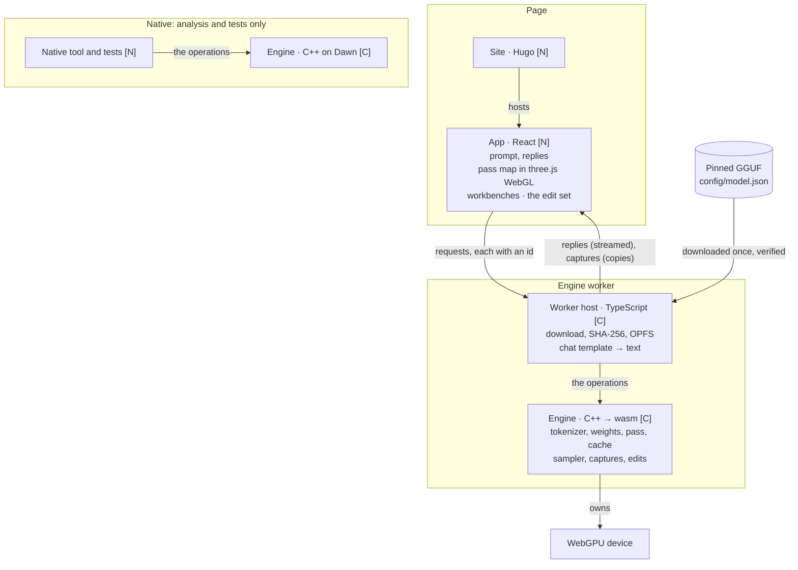
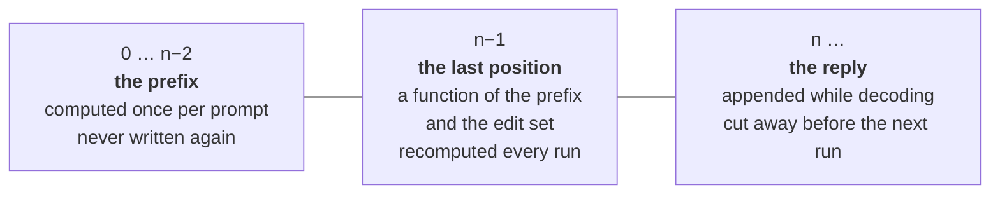
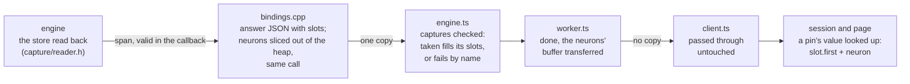
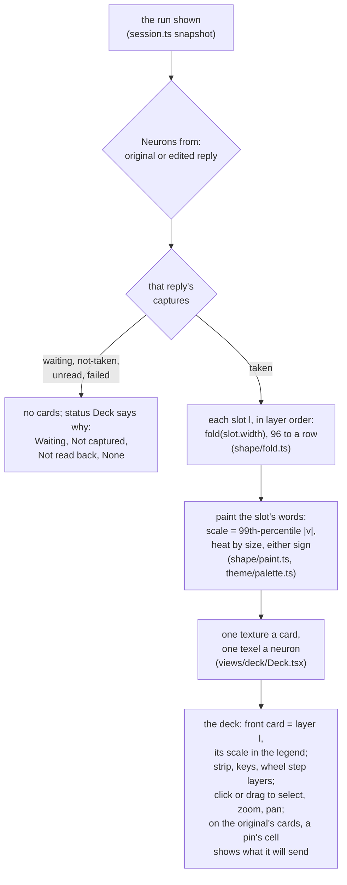
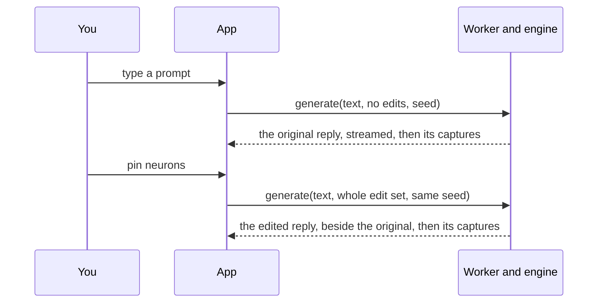

# Logical overview

Draft for review, 2026-10-27. What Frizzle is made of, what state it keeps,
and where values are read and changed. Decisions themselves are in
[MEMORY](../process/MEMORY.md).

**Legend:** **[P]** ported from Charlotte as it is · **[C]** ported, then
changed · **[N]** new. ◉ capture · ✎ edit.

## The parts

Arrows are labelled: what crosses, or who owns what.

One engine source, two builds, one `webgpu.h`. Everything the native tool and
the tests exercise is the same code the browser runs.

The worker host renders the chat template, so the page sends only the
prompt's text. Charlotte renders it on the page; it moves here to sit with
the file it is read from.

| Part | Owns | Offers | Does not own |
| --- | --- | --- | --- |
| Site | Pages, the family shell | A home for the built app | Anything in the model |
| App | The edit set, what is on screen, copies of captures | Requests | The device, the model, tokens |
| Worker host | The file: download, verify, cache; the chat template | The worker side of the protocol | The GPU |
| Engine | Weights on the GPU, the cache, the sampler | `load`, `generate` | The page; the file on disk |
| Native tool, tests | Fixtures, references | Nothing to the product | Anything the browser build does not also do |

## The operations

| Operation | Does | Returns |
| --- | --- | --- |
| `load(file)` | Read the GGUF, put the weights on the GPU | Ready, or a named refusal |
| `generate(text, edits, seed)` | Run the model over the rendered prompt, the edits applied at the last position and held at every generated token | The reply, streamed; then its end and every layer's neurons at the last prompt position |

Frizzle shows what the model produces and computes nothing beside it. The
cache keeps the prompt's prefix between runs, so running the same prompt
with other edits recomputes only the last position before decoding.

## The state: the cache in three parts

These are Frizzle's requirements on the cache. Cutting the reply away never
recomputes the prompt, whatever the reply's length. Charlotte's cache is where
the code starts, and it changes wherever it falls short.

## Inside one layer: where values are read and changed

Top to bottom is the order of work for position n−1.

Each capture is copied out at its point into a capture store with a slot
per layer, so it holds what the model used even if the buffer it came from
is reused. Every run sends the whole store to the page, so switching layers
never asks the engine for anything.

| Per layer, at f32 | Size | Captured |
| --- | --- | --- |
| Neurons, 6,912 | 27 KiB | From slice 4: 702 KiB a run for 26 layers |
| Residual, 1,152 | 4.5 KiB | With the pass map (slice 5) |
| Q, 4 heads × 256 | 4 KiB | With the pass map (slice 5) |
| Attention weights, 4 heads × positions | 16 B per position | After them (slice 5) |
| **All of them, 26 layers, 512-token prompt** | **about 1.1 MiB** | |

That is a small fraction of one decode step's reads (the 722 MB of
weights). An edited stage is captured after its
edit: the screen shows what the model used. The unedited values are the
store from the run without edits, which the app keeps.

Editing the residual (slice 7) lands between the add and the normalization,
which are one kernel today. How to open that up is slice 7's design.

## A run's captures: when the store is written and read

The store is written once a run, inside the step that ends the prompt, and
read once, after the turn ends. The capture launch runs in every step that
asks for logits; it tells the step that ends the prompt from a decode step by
whether the step's token was fed from the last draw
([capture.h](../../src/core/capture/capture.h)).

- The store is never cleared. Only a turn whose step that ends the prompt
  ran is read, so the page is never shown an earlier run's neurons as this
  run's.
- The turn's own result is reported as it was in every case: a capture never
  turns a reply into a failure, or a failure into a reply.
- Cost, estimated and not measured: 26 dispatches a decode step that read
  one word and stop, about 40 µs a token, as the edit launch costs; once a
  run, 702 KiB copied on the GPU and one readback.

How a run's neurons reach the page, once a run, with its answer:

One copy in all, out of the module's memory: the worker hands the buffer to
the page, and the page reads it where it lies.

How the deck draws them (slice 4, step 3), on the page, when the shown
captures change and never per frame:

The deck and the inspector read the same snapshot as the conversation; the
only thing they change in the session is the pins held for the next run.
The scale is per layer and is shown in the legend, and every value is still
the model's own, rounded for reading and exact in the inspector's data.

## The loop

The original reply is generated once per prompt, before any edit, and kept.

## What must stay true

1. The prefix, 0 … n−2, is computed once per prompt and never written again.
2. Position n−1 depends only on the prefix and the edit set, and is
   recomputed on every run.
3. With no edits, or Scale × 1, the reply is bit for bit the original.
4. The app sends the whole edit set with every run. Neither holds a change
   list for the other.
5. A capture is a copy taken inside the pass at its point. An edited stage is
   captured after its edit. The capture store always holds the last run's
   values, for every layer, and is sent whole.
6. The original and edited replies use the same seed. The sampler is keyed by
   seed and position, and edits are applied at every decode step, so the edits
   are the only difference.
7. Every request carries an id, and the page shows only the answer to its
   latest one.

## Not settled here

- Whether gate and up are shown separately (new kernel outputs).
- How the residual edit opens up the add-and-norm kernel (slice 7).
