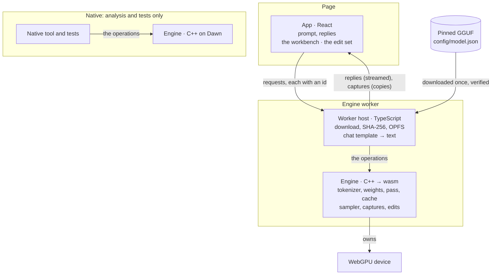
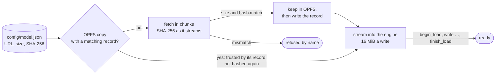
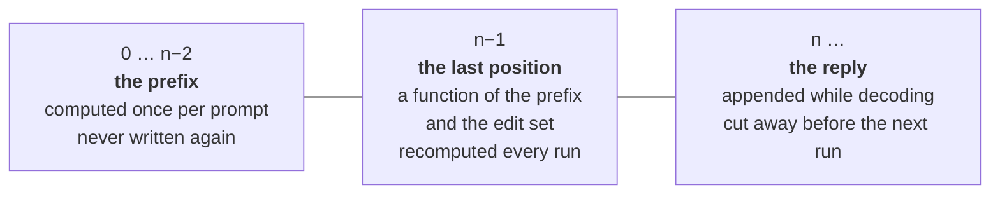
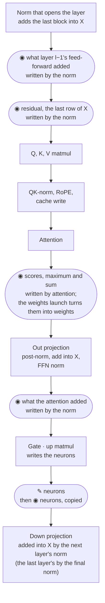
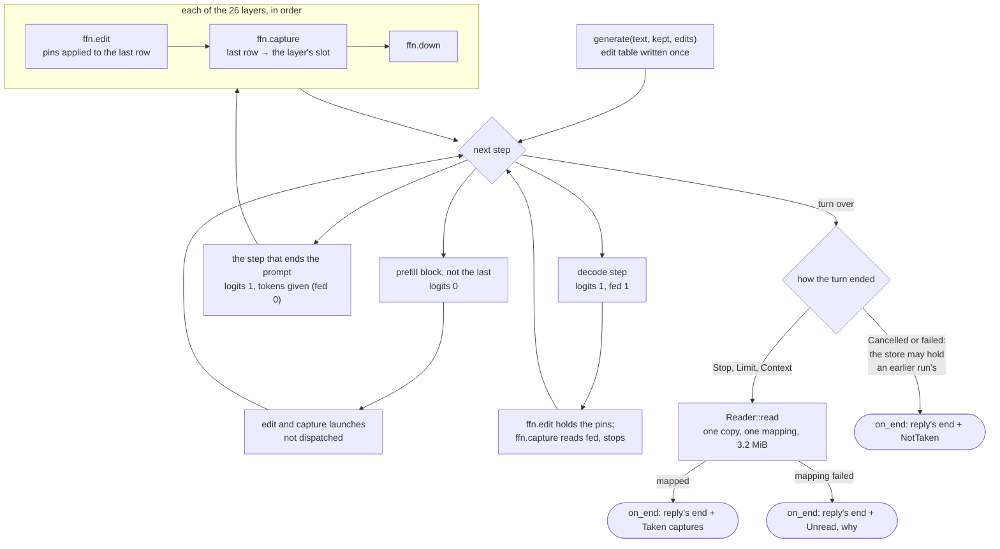
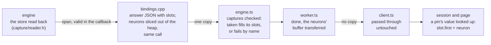
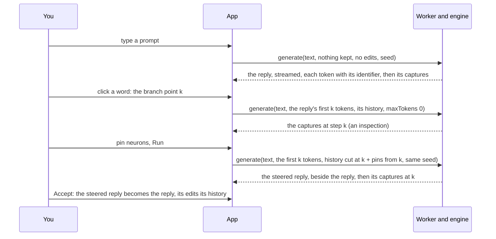

# Logical overview

What Frizzle is made of, what state it keeps, and where values are read and
changed. ◉ capture · ✎ edit.

## The parts

Arrows say what crosses, or who owns what.

One engine source, two builds, one `webgpu.h`. Everything the native tool and
the tests exercise is the same code the browser runs.

| Part | Owns | Offers | Does not own |
| --- | --- | --- | --- |
| App | The edit set, what is on screen, copies of captures | Requests | The device, the model, tokens |
| Worker host | The file: download, verify, keep; the chat template | The worker side of the protocol | The GPU |
| Engine | Weights on the GPU, the cache, the sampler, the capture store | `load`, `generate` | The page; the file on disk; the chat template |
| Native tool, tests | Fixtures, the frozen reference | Nothing to the product | Anything the browser build does not also do |

The worker renders the chat template, so the page sends only a message's
text and the engine reads text already rendered. The template writes Gemma
3's `<bos>` and turn markers; the engine checks none of it, and text wrapped
otherwise runs and gets whatever reply the model makes of it. The native
tool wraps one user message by hand.

## The model

One file, pinned by size and SHA-256 in `config/model.json`; a download that
does not match is refused.

| | Gemma 3 1B, instruction-tuned, Q4_0 GGUF |
| --- | --- |
| File | 721,918,496 bytes |
| Layers | 26 |
| Residual width | 1,152 |
| MLP width (neurons) | 6,912 |
| Attention | 4 query heads sharing 1 key/value head, 256 wide |
| Attention span | Local, 512 keys, in five of every six layers; global in every sixth |
| Trained context | 32,768 tokens |
| Weight formats | Q4_0 attention, gate and up; Q4_1 for three `ffn_down`; F32 norms |
| Token embedding | Q8_0, about 321 MB, also the output head |
| KV cache | F16 |
| Decode speed in the browser | About 140 tok/s, estimated, not measured |

## The operations

| Operation | Does | Returns |
| --- | --- | --- |
| `load`, in three calls: `begin_load`, `write`, `finish_load` | Read the GGUF's index and tokenizer, plan residency within the device's limits, take the file's bytes in order, build the graph | Ready, or a named refusal |
| `generate(text, kept, edits, policy)` | Run the model over the rendered text and the reply tokens a branch keeps, each edit at the steps its range holds; a limit of 0 inspects, drawing nothing | The reply, streamed a token at a time with its identifier; then its end, its identifiers, and every layer's captures at step k |

Step k is the position that draws reply token k: the input's last position.
A run from the reply's start is k = 0, the prompt's last position.

The page sets no limit on a reply's length: a reply ends when the model ends
its turn, the context is full, or Stop cancels it. A strong edit can make
the model repeat itself to the end of the context.

## Loading

- The engine runs in a plain Web Worker as one ES module (`frizzle.mjs` and
  its `.wasm`), with no SharedArrayBuffer, so the page needs no cross-origin
  isolation.
- A load can be cancelled while it downloads. Once it streams into the
  engine it runs to its end, a few seconds: the engine cannot abandon a load
  half made. A generation can be cancelled at any time.
- The module's heap starts at 128 MiB and may grow to 1 GiB. Both are
  estimates, not measured.

## The state: the cache in three parts

Cutting the reply away never recomputes the prompt, whatever the reply's
length. The cache keeps edited entries with the edits of the run that wrote
them; a run reuses it only up to the first position whose tokens or edits in
force differ (invariant 1).

## Inside one layer: where values are read and changed

Top to bottom is the order of work at step k.

Each capture is written at its point into the capture store, a slot per
layer and kind, so it holds what the model used even if the buffer it came
from is reused (`capture/capture.h`).

| Captured value | Written by | Why there |
| --- | --- | --- |
| Neurons | A copy launch of its own, after the edit | An edited stage is captured after its edit: the screen shows what the model used |
| Residual, what each block adds | The norm kernel | The added vector exists only in its registers |
| Attention scores, maximum and sum | The attention kernel, for the last row | Only it has the scores |
| Attention weights | A launch after attention (`capture/weights.h`) | The raw scores, in log2 units, cannot be read; the weights differ from the factors the model applied by rounding only |

The attention weights are the one value formed beside the model's own
outputs, on the GPU in the same step, from the attention kernel's scores.

| Per layer, at f32 | Size |
| --- | --- |
| Neurons, 6,912 | 27 KiB |
| Residual, 1,152 | 4.5 KiB |
| What the attention adds, 1,152 | 4.5 KiB |
| What the feed-forward adds, 1,152 | 4.5 KiB |
| Attention weights, 4 heads × keys | 8 KiB for a 512-key window; 512 KiB for a global layer, sized to the trained 32,768 |
| Each head's softmax maximum and sum | 32 B |
| **The store, 26 layers** | **3.2 MiB, 2 MiB of it the 4 global layers' weights** |

That is a small fraction of one decode step's reads, the 722 MB of weights.
The unedited values are the store from the run without edits, which the app
keeps.

## Edits

| | |
| --- | --- |
| What | MLP neurons: Set to a value, Scale ×, Zero |
| How many | A set, any number of neurons in any layers, applied together in one pass |
| Where | Inside the pass, on the neurons' row, at every step its range holds |
| When | From the branch point k on, held at every generated token |
| Cost when off | The edit launch runs once a layer in every step, over every row, edits or not, and edits only the rows whose position a range holds: about 40 µs a step, estimated, not measured |

## A run's captures: when the store is written and read

The store is written once a run, inside the step that ends the prompt, and
read once, after the turn ends. The copy and weights launches run in every
step that asks for logits; they tell the step that ends the prompt from a
decode step by whether the step's token was fed from the last draw. The norm
and attention run in every step, so they also read whether the step asks for
logits (`capture/capture.h`). The diagram follows the neurons; the other
captures are written in the same step.

- The store is never cleared. Only a turn whose step that ends the prompt
  ran is read, and that step writes every word of it, so the page is never
  shown an earlier run's captures as this run's.
- The turn's own result is reported as it was in every case: a capture never
  turns a reply into a failure, or a failure into a reply.
- Cost, estimated and not measured: 52 dispatches a decode step (the copy's
  and the weights') that read the step and stop, about 80 µs a token; once a
  run, 3.2 MiB copied on the GPU and one readback.

How a run's neurons reach the page, once a run, with its answer. The rest of
the store is read back with them and stays in the engine.

One copy in all, out of the module's memory: the worker hands the buffer to
the page, and the page reads it where it lies. All 26 layers' neurons, 702
KiB, cross on every run, so switching layers needs no request.

## The loop

The reply is generated once per prompt and seed, before any edit; after
that every run keeps its tokens to the branch point, and an accepted steered
reply takes its place. Requests run one at a time, since the engine runs one
turn at a time. [Interface](interface.md) has what the page shows at each
point.

## What must stay true

1. A position's cache entry is a function of the tokens up to it and the
   edits in force at it. A run reuses the cache only up to the first
   position where either differs from the run that wrote it, and computes
   the rest; the prompt is never computed again while they agree.
2. The branch position, step k, the input's last, depends only on what
   comes before it and the edits in force there, and is recomputed on every
   run. For a run from the reply's start, k = 0, it is position n−1.
3. With no edits, or Scale × 1, the reply is bit for bit the original; a
   branch with a reply's own edits continues that reply bit for bit.
4. The app sends the whole edit set with every run, and the reply tokens a
   branch keeps. Neither holds a change list for the other.
5. A capture is a copy taken inside the pass at its point, step k. An edited
   stage is captured after its edit. The capture store always holds the
   last run's values, for every layer, and is read back whole.
6. Every run of one reply uses its seed. The sampler is keyed by seed and
   position, and edits apply at exactly the positions their ranges hold, so
   the edits are the only difference between a reply and a branch from it.
7. Every request carries an id, and the page shows only the answer to its
   latest one.
8. An accepted reply is its tokens and the edits it was generated with,
   each over its range; the page holds both, and recomputing it from them
   gives it again.

## Pinned versions

Every version that decides behavior is pinned in one place. Tools are
installed by hand; the scripts refuse another LLVM or Node and install
nothing.

| What | Where it is pinned |
| --- | --- |
| The model file | `config/model.json` |
| Browser build: Emscripten in the `emscripten/emsdk` container, with its `emdawnwebgpu` port | `CMakeLists.txt`, `scripts/tooling.py` |
| Native build: LLVM clang, against prebuilt Dawn, the release the browser port comes from | `cmake/dawn.json`, `scripts/tooling.py` |
| clang-format and clang-tidy, the native build's LLVM | `scripts/tooling.py` |
| doctest, fetched by CMake by commit | `tests/CMakeLists.txt` |
| Node, refused otherwise | `app/.nvmrc` |
| npm packages, exact versions, installed with `npm ci` and no install scripts | `app/package.json`, `app/package-lock.json`, `app/.npmrc` |
| IBM Plex fonts, kept in the app by SHA-256 | `app/src/theme/fonts/README.md` |

Native builds run on macOS arm64 and Linux x86-64. Both builds compile
against one `webgpu.h`, so moving the Dawn pin or the Emscripten pin moves
both.
